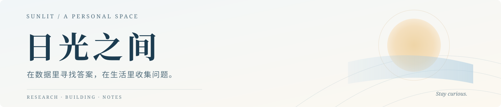
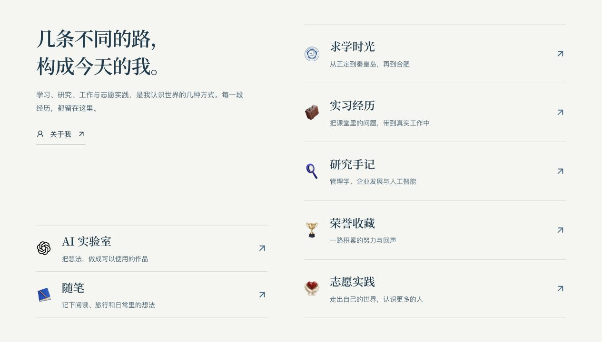
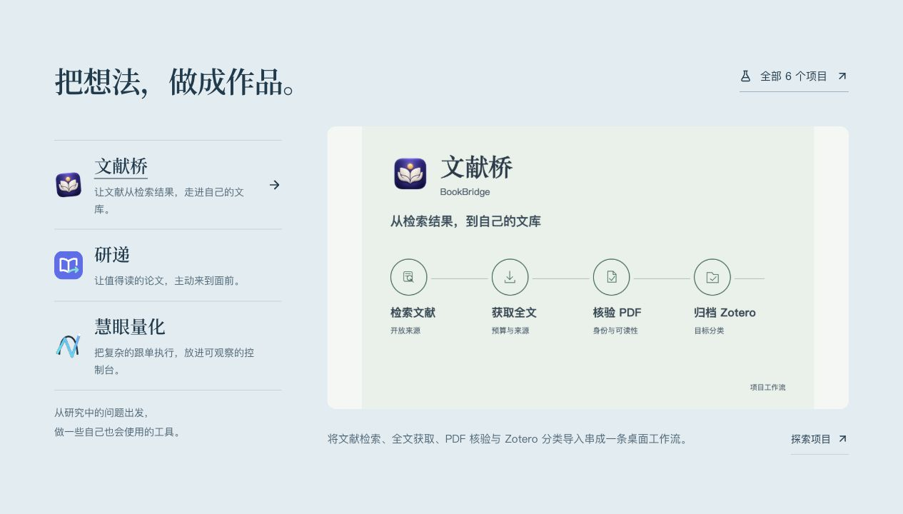
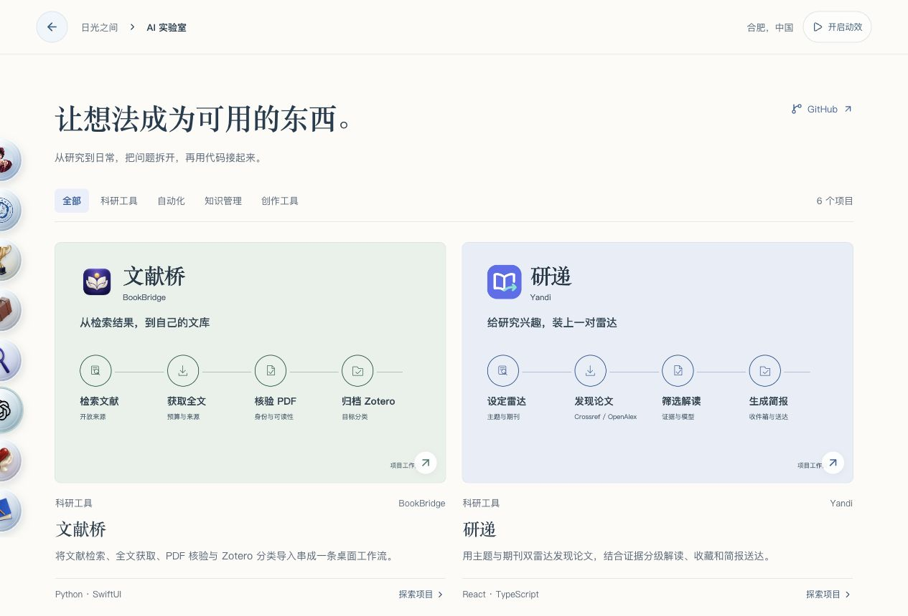
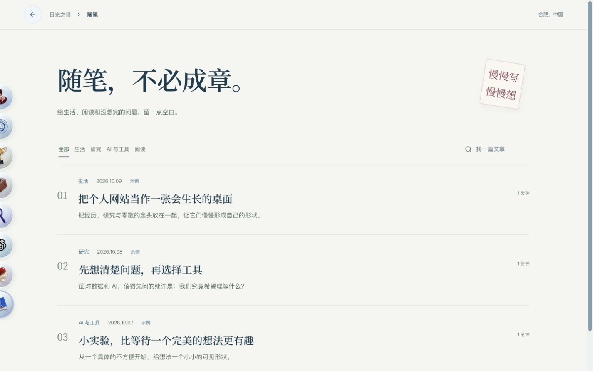
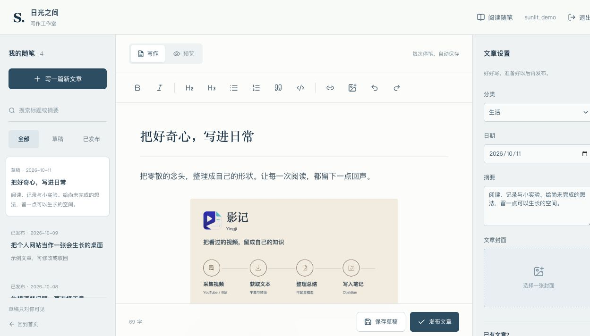
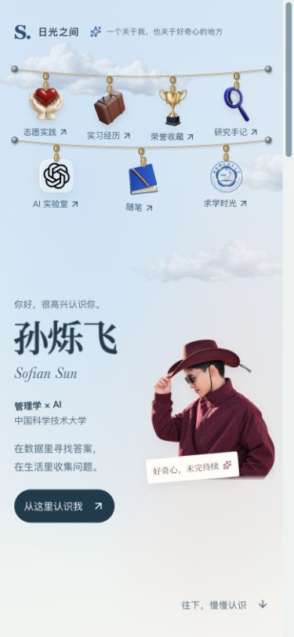

<p align="center">
  
</p>

<p align="center">
  <b>一个关于经历、作品与好奇心的个人空间。</b><br />
  从求学与研究，到 AI 实验与日常随笔，把不同的自己放在同一片天空下。
</p>

<p align="center">
  <a href="http://49.234.27.200/">浏览网站 ↗</a>　·　
  <a href="#把想法做成作品">AI 实验室</a>　·　
  <a href="#给文字和照片留一点空间">图文随笔</a>　·　
  <a href="#在本地开始">本地运行</a>　·　
  <a href="deploy/README.md">部署指南</a>
</p>

<a href="http://49.234.27.200/">
  
</a>

<p align="center">
  <sub>7 个个人板块　/　6 个项目　/　43 份经历材料　/　一间自己的写作工作室</sub>
</p>

## 让经历有形，让想法留痕

这是一份可以慢慢展开的个人介绍，也是一处持续更新的记录空间。求学、实习、研究、荣誉与志愿实践有各自的页面；做过的项目可以看到功能与实现，生活里的想法可以写成图文随笔。

**从物件出发。** 首页标识与介绍语直接放在天空中。奖杯、放大镜、笔记本与校徽沿着自然下垂的绳索悬挂，轻轻划过便会摆动。点击物件，进入相应的全屏板块；贴在左侧边缘的玻璃圆球，让页面之间的切换保持轻巧。

**让画面有呼吸。** 云朵缓慢飘动，人像从下方升起，姓名在鼠标靠近时显现轮廓细节，鼠标移动留下渐变流体光迹。手机端保留左右排布与两排入口，动态效果遵从系统的减少动态设置。

**一屏一段，慢慢认识。** 首页按天空、经历、AI 作品与随笔分为四屏，内容可以完整容纳时，滚动松手后吸附到完整画面。经历入口的左右底边保持对齐；矮窗口、放大排版或内容超出一屏时自动放松吸附，让文字和图片完整展开。





**让作品有主次。** AI 作品区以一个大幅展台配合三个项目选项，点击或使用方向键切换预览，再进入完整的项目介绍。中文标题使用本地托管的 Noto Serif SC，首页和内页共享纸面、墨色与字体。

**让内容持续生长。** 经历材料可以分类、放大和翻页；文章可以在自己的后台整理、插图、保存草稿与发布。网站的更新不必每次都修改源码。

## 把想法做成作品

AI 实验室收集从具体问题出发的项目。每个项目都有图文介绍、工作流、技术栈与来源说明，可以按科研工具、自动化、知识管理和创作工具分类浏览。



| 项目 | 从什么问题出发 |
| --- | --- |
| **文献桥 · BookBridge** | 连接文献检索、全文获取、PDF 核验与 Zotero 归档。 |
| **研递 · Yandi** | 用主题与期刊双雷达发现论文，整理阅读简报。 |
| **慧眼量化 · HuiYan QuantBot** | 通过 Telegram 与移动 WebApp 管理跟单、账本和风险操作。 |
| **影记 · Yingji** | 将视频字幕与模型总结，沉淀为可继续使用的知识笔记。 |
| **脉见 AI · Maijian AI** | 汇集跨平台内容，结合上下文分析与消息推送。 |
| **豆格工作室 · Douge Studio** | 把图片转换为拼豆图纸，并连接调色、精修与材料统计。 |

项目展示依据实际仓库整理，二次开发来源与许可保留在项目介绍中。部分项目仓库为私有；展示内容可浏览，源码访问取决于仓库权限。

## 给文字和照片留一点空间

随笔页采用暖白纸面、宋体标题和安静的留白，只保留一层顶部导航。可以按分类浏览、搜索文章，也可以打开单篇慢慢阅读；“慢慢写，慢慢想”的纸便签是站点主人的管理入口，手机端同样可见。



背后是一间独立的图文写作工作室：写文字、插入图片、设置封面，也可以从已有的 Word、Markdown 或 TXT 开始，PDF 则保留为原稿附件。



- **写作与配图**：标题、列表、引用、代码、链接、图片说明与替代文字；支持粘贴或拖入图片。
- **草稿与发布**：停笔后自动保存；修改已发布文章时，访客继续看到上一版，确认更新后才替换。
- **自己的数据**：SQLite 保存文章，文件目录保存图片与原稿；独立管理员登录，支持完整备份。

<sub>随笔列表中的初始文章是样例；工作室截图使用独立演示数据，未包含正式文章或管理员凭据。</sub>

## 在小屏幕上，也保留同一种气质

<table>
  <tr>
    <td width="38%" align="center">
      
    </td>
    <td width="62%">
      <h3>把一片天空，装进口袋。</h3>
      <p>姓名与人像左右排列，悬挂入口分为两排。进入个人板块后，边缘圆球导航为正文留出更多空间。</p>
      <p>手机上用点击探索，桌面上用悬停感受轻摆。动效遵从设备与个人偏好；减少动态效果时，文字与内容仍完整呈现。</p>
      <p><b>关于我 · 求学时光 · 荣誉收藏<br />实习经历 · 研究手记 · AI 实验室<br />志愿实践，以及持续更新的随笔</b></p>
    </td>
  </tr>
</table>

## 在本地开始

需要 **Node.js ≥ 22.13.0**，已在 Node.js 24.16.0 上验证。

```sh
git clone https://github.com/xiaofei03/xiaofei03.ren.git
cd xiaofei03.ren
npm ci
npm run dev
```

打开 **[http://127.0.0.1:5173/](http://127.0.0.1:5173/)**。首次管理随笔时运行 `npm run admin:setup`，在本机读取命令提示的初始化密钥文件，再从 `/admin/setup` 创建自己的账号。

| 想做什么 | 从这里开始 |
| --- | --- |
| 修改个人经历 | [`app/content.ts`](app/content.ts) |
| 整理项目介绍 | [`app/project-data.ts`](app/project-data.ts) |
| 添加证书材料 | [`app/awards.json`](app/awards.json) 与 [`public/assets/certificates/`](public/assets/certificates/) |
| 调整首页与动效 | [`app/home-scene.tsx`](app/home-scene.tsx)、[`components/`](components/) |
| 写文章、上传配图 | 点击随笔页“慢慢写，慢慢想”，登录后进入 `/studio` |
| 部署到自己的服务器 | [部署说明](deploy/README.md)与[配置示例](.env.example) |

<details>
<summary><b>技术栈与进一步阅读</b></summary>

<br />

| 层次 | 实现 |
| --- | --- |
| 页面与路由 | React 19 · TypeScript · Vinext / Vite |
| 视觉与交互 | GSAP · React Bits · CSS · WebGL 流体效果 |
| 图文编辑 | Tiptap · Mammoth · Markdown |
| 数据与管理 | Node.js · SQLite · 独立管理员与会话 |
| 服务器运行 | Nginx · systemd · Certbot · 一致快照备份 |

```sh
npm run check        # TypeScript 检查
npm run build        # 生产构建
npm run start -- --port 5183
```

- [功能与实现说明](docs/implementation.md)：动画适配、编辑器能力、内容来源与迁移。
- [服务器部署](deploy/README.md)：目录约定、持久化、备份、域名和 HTTPS。
- [展示素材来源](docs/media/README.md)：截图范围与演示数据说明。

</details>

## 访问与来源

**2026-10-11：** [公网 IP](http://49.234.27.200/)提供只读预览，手机可以直接访问。`xiaofei03.ren` 仍在备案审核，域名与正式 HTTPS 尚未启用；管理暂时使用 SSH 私有入口。

网站的经历来自本人简历与材料，三篇初始随笔和部分性格文案为样例。视觉借鉴 Elliot Hu 的个人桌面与拼贴表达，页面重新实现。React Bits、编辑器和项目素材的来源及许可说明保留在 [功能文档](docs/implementation.md)、[`licenses/`](licenses/) 和素材目录中。

仓库包含完整网站源码与静态素材。真实环境配置、文章数据库、初始化密钥、管理员凭据和私有备份保留在仓库之外。

---

<p align="center">
  <sub>日光之间 · 记录好奇，慢慢生长。</sub>
</p>
